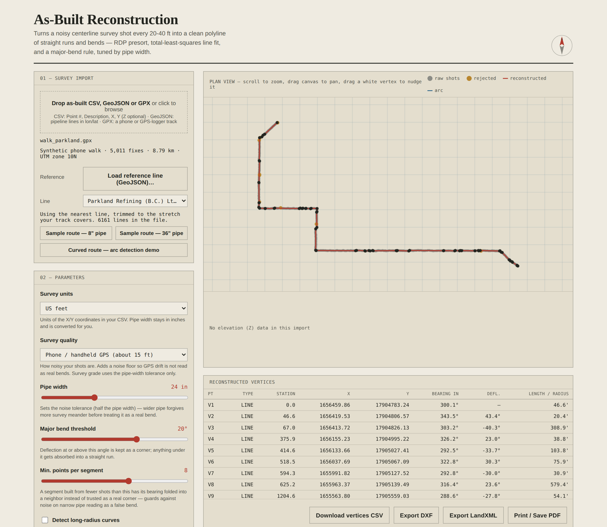

# As-Built Pipeline Reconstruction

A survey crew walks an installed pipeline taking a shot every 20-40 ft. Those
shots meander left and right of true centerline — even on straight runs —
because the crew is walking alongside pipe that's 8-36+ inches wide, not a
single infinitesimal line. Turning that noisy point chain back into a clean
polyline of straight runs and bends is normally 4-8 hours of manual work in
CAD. This does it in a browser tab.

[](https://github.com/aditya1234u5/asbuilt-reconstruction/actions/workflows/test.yml)
[](LICENSE)

**[Live demo](https://aditya1234u5.github.io/asbuilt-reconstruction/)** — runs entirely in your browser, no upload, no backend. Click **Sample route** to try it instantly.


*The 8″ sample route: 59 raw survey shots reduced to 5 vertices (92% reduction), max residual 2.87 ft, with the elevation profile underneath.*


*The **Curved route** sample: a true R = 400 ft sweep is recovered as line + arc + line.*

## How it works

1. **RDP presort** — Ramer-Douglas-Peucker simplification with a tolerance of
   half the pipe width. Wider pipe forgives more meander before a wiggle
   looks like a real bend; narrower pipe keeps tighter tolerance.
2. **Line fit** — each candidate segment is fit with total-least-squares
   (2D PCA), not ordinary `y = mx + b` regression, so it handles any
   orientation including near-vertical runs.
3. **Bend merge** — neighboring segments are folded together whenever their
   deflection is under the major-bend threshold (default 10°) **or** a segment
   doesn't yet have enough raw points for its bearing to be trustworthy (a 2-3
   point segment can have a bearing that's wrong by 20-30° purely from survey
   noise). The merge **order** is by fit quality: the pair whose points are
   best explained by a single straight line goes first. Ordering by
   deflection instead is unreliable early on, when segments hold only 1-2
   shots and their bearings mean nothing; that let an under-sampled piece be
   forced into the wrong neighbour across a real corner. Fixing it cut lost
   bends from about 7% of true bends to under 0.5% (see the evaluation).
4. **Outlier rejection** — a robust, MAD-based check per segment flags shots
   sitting far outside *that segment's own* noise level (equipment error,
   not routine meander) and refits without them.
5. **Vertices** — reconstructed as the geometric intersections of
   consecutive fitted lines, not as any single raw survey shot, then
   stationed (cumulative distance along the route).
6. **Elevation** — if your CSV has a Z column, each segment also gets a
   1D least-squares elevation fit, plotted as a profile under the plan view.
7. **Curve detection (optional)** — groups 2+ consecutive, same-direction,
   moderate-angle bends into one fitted circular arc (Kasa algebraic circle
   fit) instead of a chain of sharp corners, for routes with genuine
   long-radius sweeps rather than mitered elbows. Straight lead-in/lead-out
   runs are trimmed off the arc (a tangent is much longer than the chords of
   a real curve), so they stay straight lines instead of being folded into
   the fit. This is a post-process over whatever vertices the main pipeline
   already produced — if a high "min points per segment" setting already
   merged part of a curve into an adjacent straight run, the detected arc can
   still bleed slightly into it. Off by default; enable
   with the "Detect long-radius curves" checkbox, or click **Curved route**
   to see it work.

Bearing and deflection follow surveying convention: bearing is azimuth from
north (`atan2(dx, dy)`, not the usual `atan2(dy, dx)`), and deflection is the
signed turn between two bearings, wrapped correctly across the 0°/360°
boundary.

## Project structure

```
.
├── index.html              entry point
├── css/
│   └── style.css           survey/CAD-styled UI (light vellum + dark cyanotype) + print stylesheet
├── js/
│   ├── algorithm.js         reconstruction, arc detection, DXF/LandXML export — no DOM, unit-testable
│   ├── geojson.js           GeoJSON line extraction, lon/lat → UTM projection, survey simulator — no DOM
│   ├── fidelity.js          compares the result with a reference line (both directions) — no DOM
│   ├── autotune.js          picks the fewest vertices that still follow the line — no DOM
│   ├── gpx.js               GPX track/route parser, tolerant of truncated files — no DOM
│   ├── reference.js         find the right reference line and trim it to your track — no DOM
│   ├── quality.js           survey-quality presets (noise floor for GPS drift) — no DOM
│   └── app.js                CSV import, parameters, canvas rendering, tables, export buttons
├── tests/
│   ├── algorithm.test.js    unit tests (Node's built-in test runner, no dependency)
│   ├── geojson.test.js      GeoJSON import tests
│   ├── fidelity.test.js     fidelity-check tests
│   ├── autotune.test.js     auto-tune tests
│   ├── gpx.test.js          GPX parser tests
│   ├── reference.test.js    reference matching / trimming tests
│   ├── quality.test.js      survey-quality preset tests
│   └── gpx-pipeline.test.js end-to-end: synthetic phone-GPS walk -> GPX -> result vs reference
├── eval/
│   └── evaluate.js          accuracy evaluation on synthetic routes with known ground truth
├── docs/
│   ├── EVALUATION.md        generated results (npm run eval)
│   └── screenshot*.png
├── sample-data/
│   ├── sample_8in_pipe.csv   synthetic as-built route, narrow pipe
│   └── sample_36in_pipe.csv  same route, wide pipe — fewer surviving vertices
├── package.json
├── LICENSE
└── README.md
```

`algorithm.js` has no dependency on the DOM or any UI library — you can
import it into a Node script, a test file, or a different front end without
changes.

## Running the tests

```bash
npm test
```

70 tests covering bearing/deflection math, RDP, PCA line fit, point
conservation (no raw shot is ever duplicated or lost across the whole
pipeline), pipe-width sensitivity, stationing, elevation fit, circle fit,
arc detection, regression tests for the lost-corner bug (with and without
gross outliers), feet/metre conversion, both export formats, the GeoJSON
import (UTM projection checked against pyproj to under 1 mm), the GPX parser
(including truncated files), reference-line matching and trimming, the
survey-quality presets, the fidelity check, Auto-tune, and an end-to-end
phone-GPS walk.

## Accuracy

`npm run eval` runs the pipeline on synthetic routes with known ground truth
and writes the results to [`docs/EVALUATION.md`](docs/EVALUATION.md): noise
levels and pipe widths, injected gross outliers, a curved route, gentle long
curves (default settings versus Auto-tune), and a synthetic phone-GPS walk
with drifting error. It is synthetic data only (see the caveats in that
file), but it is a measured comparison rather than a claim. Headlines at the
default settings: no true bend is lost in 200 runs of the corner route at 8"
pipe (600 bend checks), and on the curved demo the ideal line + arc + line comes out 100% of
the time at 0.5-2 ft noise. A correct vertex *count* still does not guarantee
correct geometry, which is why the check below exists.

## Fidelity check

Under the result numbers the app shows a **GOOD FIT / CHECK / POOR FIT** badge
answering one question: does the reconstructed line actually follow the line it
was built from? It measures the distance between the two lines in **both
directions** (a result that cuts corners *and* one that invents corners are
both caught), sampled along the lines every ~10 ft rather than only at
vertices, and shows mean distance, max distance, the share of the line more
than 25 ft off, the length difference, and the average spacing of the input.

- **What it compares against.** For a GeoJSON line, the original clean line
  (so with simulated shots it reports the real recovery error on synthetic
  noise). For CSV and the samples, the input shots joined in order.
- **Why it exists.** The method needs shots every ~20–40 ft. Fed a sparse line
  (one point every few hundred feet) it mistakes real corners for noise and
  produces a confident-looking but wrong result — e.g. one BCER line with 33
  vertices came back 7.5% short with the line up to 1,057 ft off. That now
  shows as **POOR FIT** with the numbers.
- **The thresholds are heuristics**, set by running the check over the sample
  routes and dense BCER lines (all within 2% of the line off-tolerance and 1.1%
  length difference) and over known-bad inputs (60–97% off-tolerance). CHECK
  starts at 3% off-tolerance or 2% length difference; POOR at 10% or 5%. The
  raw numbers are always shown so you can judge for yourself.
- **Not ground truth for real data.** For real survey input it measures
  fidelity to what you gave it, not accuracy against the real pipe.

## Running it locally

Because `app.js` is loaded as an ES module, opening `index.html` directly via
`file://` will hit CORS restrictions in most browsers. Serve it instead:

```bash
# any static server works, e.g.:
python3 -m http.server 8000
# or
npx serve .
```

Then open `http://localhost:8000`.

## CSV format

Any CSV with X and Y columns works — the app auto-guesses common header
names (`X`/`Easting`, `Y`/`Northing`, `Z`/`Elevation`, `Point #`,
`Description`) and lets you remap them if it guesses wrong. Choose the units
of your X/Y coordinates (**US feet** or **meters**) in the *Survey units*
control; the pipe-width slider stays in inches and is converted for you. The
chosen unit labels the results and is written into the LandXML export.

Two ready-made CSVs are in `sample-data/` if you want to test without your
own data, or just click a sample route in the app itself (the two corner
routes, or the **Curved route** that shows arc detection). Samples are
generated in feet.

## GeoJSON import

You can also drop a **GeoJSON** file of pipeline lines (for example a download from a government open-data portal). The app finds every `LineString` / `MultiLineString` feature, lets you pick one from a searchable list, and projects its longitude/latitude to UTM (`js/geojson.js`) in your chosen unit (feet or metres).

GeoJSON holds the clean *centreline*, not noisy survey shots, so by default the app simulates a survey: one shot every 20-40 ft, each pushed up to half the pipe width off the line. Untick **Simulate survey shots** to feed the raw GeoJSON vertices in directly. That only works for lines whose vertices are close together (the picker shows each line's average spacing as "ft apart"); for a sparse line the app says so and offers a **Jump to a dense line** button.

## GPX tracks and reference lines (real GPS data)

Drop a **GPX** file from a phone or GPS logger. The app reads the track (or
route), projects it to UTM, and reconstructs it like any other survey. Files
cut short by a crashed logger still load: whatever points were recorded are
used.

- **Survey quality.** Survey-grade shots are good to an inch or two, so pipe
  width alone sets the noise tolerance. A phone is typically 3-5 m (10-16 ft)
  off, and that error *drifts* rather than jumping around, so at survey-grade
  tolerance it is read as real bends. The **Survey quality** control adds a
  noise floor (mapping-grade about 1 ft, phone about 15 ft); loading a GPX
  switches it to *phone* automatically.
- **Reference line (optional, and what makes the result a measurement).** Load
  a GeoJSON of the official centreline for the road or pipe you walked. The app
  picks the line nearest your track, trims it to the stretch you actually
  covered, and the fidelity check then reports real distance from that line.
  You can choose another candidate from the list.
- **Auto-tune** picks the setting that gives the fewest vertices while still
  following the reference.



*A synthetic phone-GPS walk (5,011 fixes) with a 6,161-line BCER GeoJSON loaded as the reference: the nearest line is found automatically, trimmed to the walked stretch, and the result is rated GOOD FIT. The walk is simulated, not a real recording.*

On a *synthetic* phone-GPS walk (drifting 3 m error, 5 true vertices),
survey-grade tolerance gave 127 vertices on average and 16 of 20 results rated
POOR; the phone setting gave 46 and 17 of 20 GOOD; with Auto-tune, 19 vertices
and 20 of 20 GOOD. See section 5 of [`docs/EVALUATION.md`](docs/EVALUATION.md).
That is a model of GPS error, not field data: run a real walk before relying
on it.

## Parameters

| Control | What it does |
|---|---|
| **Pipe width** | Sets the RDP tolerance (half the width). Wider pipe → more forgiving. |
| **Major bend threshold** | Deflection at or above this angle is kept as a real corner. |
| **Min. points per segment** | A segment built from fewer shots than this doesn't get to "vote" on a bend; it is folded into whichever neighbour its points fit best. |
| **Survey quality** | Adds a noise floor for GPS drift (see the GPX section). Survey grade = pipe width only. |
| **Detect long-radius curves** | Optional. Groups consecutive moderate bends into a fitted arc instead of sharp corners — see "Curve detection" above. |
| **Auto-tune parameters** | Tries 66 bend-threshold × min-points combinations (1-20°, 3-8 points) and applies the one with the **fewest vertices that still follow the line**, judged by the fidelity check. If nothing follows the line well it says so and shows the least bad. (It used to minimise the average segment residual, which rewards over-segmentation.) |

## Other features

- **Manual vertex nudge** — drag any white vertex handle on the plan view to
  move it slightly. This edits the output directly (recomputes stationing,
  bearings, and the table) without re-running the fit — for the rare case
  the algorithm is a hair off and you want to true it up by eye. Pressing
  **Reconstruct** again discards any nudge.
- **Export** — vertices as CSV, or the full centerline (lines + any detected
  arcs) as **DXF** (AutoCAD/Civil3D) or **LandXML**.
- **Print / Save PDF** — a dedicated print stylesheet lays out the plan view,
  elevation profile, and both tables as a clean report; use the browser's
  "Save as PDF" destination in the print dialog.

## Limitations

- **It needs shots every ~20-40 ft.** Fed a sparse line (a point every few
  hundred feet) it mistakes real corners for noise and gives a confident but
  wrong result. The fidelity check flags this as POOR FIT rather than letting
  it pass, and no Auto-tune setting can fix missing data.
- **Gentle long curves need a finer bend threshold than the default 10°**,
  otherwise each small bend is absorbed and the curve is flattened (e.g. a 15
  km-radius curve: 48% of the line more than 25 ft off at the default, fixed
  by Auto-tune picking 5°). Auto-tune does this for you.
- **Arc detection is a heuristic.** Its tangent trim uses a length rule (an end
  run more than 2× the median chord is treated as a tangent). On the curved
  demo it gave the ideal line + arc + line in every trial at ±0.5-2 ft noise,
  but that is one geometry.
- **Verdict thresholds are heuristics**, calibrated on the sample routes and
  dense BCER lines; the raw numbers are always shown.
- **GPS-error model.** The phone-GPS results use a synthetic drifting-error
  model, not field data. No real survey or GPS track has been run through it
  yet.
- Single route, 2D plan geometry (elevation is fitted per segment but does not
  affect bend detection), no loops or branches.

## Deployment

The app is fully static, so GitHub Pages hosts it for free: repo **Settings → Pages → Deploy from branch → `main` → `/ (root)`**. It goes live at `https://<your-username>.github.io/<repo-name>/` within a minute or two.

## Background

Originally solved in LISP inside AutoCAD/Civil3D for as-built survey
reduction on a large engineering firm's pipeline projects; this is a from-
scratch JavaScript/browser reimplementation of the same algorithm for a
university mini project.

## License

MIT — see [LICENSE](LICENSE).
